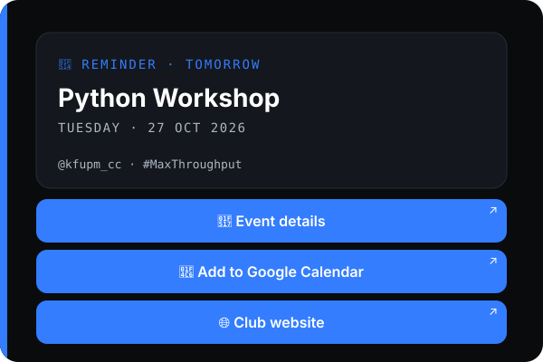

<div align="center">

<picture>
  <source media="(prefers-color-scheme: dark)" srcset="docs/assets/cc-logo-white-grey.png">
  
</picture>

<br>

<code>TELEGRAM BOT · KFUPM COMPUTER CLUB</code>

# Announce. Remind. **Show up.**

The club's Telegram bot. It posts announcements and event reminders in every club group, on time, in the club's style.

[](https://github.com/KFUPM-COMPUTER-CLUB/telegram/actions/workflows/ci.yml)


[Website](https://cckfupm.vercel.app/) · [Commands](#-commands) · [Quick start](#-quick-start) · [Brand rules](#-brand-rules) · [Contribute](workflow.md)

</div>

---

## ✨ What it does

| | |
|---|---|
| **📢 Announcements** | Post text, photos or videos to every club group at once, now or later. A link on the last line becomes a button. |
| **📅 Events** | Add an event with a date, a description, and an optional poster and link. Post it to every group as a card with `/announce event`. |
| **🔔 Reminders** | Every group gets a reminder at 9:00 AM (Riyadh time) the day before each event. Nobody has to remember. |
| **📆 Calendar** | Every event has an *Add to Google Calendar* button, plus an *Event details* button when it has a link. |
| **👥 Zero setup** | An admin adds the bot to a group and the group is registered. Remove the bot and it's forgotten. |
| **🔒 Admins only** | Every command is for club admins. `/start` shows anyone their user ID so they can be added. |

## 👀 What groups see



The day before an event, every group gets the poster with this caption. The buttons are Club Blue in Telegram apps from February 2026 on. An announcement made with `/announce event` looks the same, with an `UPCOMING EVENT` label and the event's description under the date. There's no "in 5 days" countdown, because a sent message never updates and the count would go stale.

## 💬 Commands

### General

| Command | Who can use it | What it does |
|---|---|---|
| `/help` | Admins (anyone else gets no reply) | A plain-language guide to every command, with examples you can tap to copy |
| `/start` | Anyone | Shows your Telegram user ID and explains how to add an admin |

### Admins only

| Command | What it does |
|---|---|
| **📅 Events** | |
| `/events` | Upcoming events. Tap a number to open one with its poster and buttons |
| `/addevent` | Add an event in 4 steps: name, date (`YYYY-MM-DD`), description, then the poster and link together (both optional) |
| `/editevent` | Change an event's name, date, description, link or poster |
| `/deleteevent` | Delete an event |
| **📢 Announcements** | |
| `/announce <text>` | Post to every group now. For a photo or video, put the command in its caption |
| `/announce event` | Pick an event and post it as a card: poster, name, date, description and buttons |
| `/schedule_announce YYYY-MM-DD HH:MM <text>` | Post it later (Saudi time) |
| `/schedule_announce YYYY-MM-DD HH:MM event` | Post an event card later |
| `/scheduled` | List the pending announcements |
| `/edit_announce <id> YYYY-MM-DD HH:MM <new text>` | Change a pending announcement |
| `/cancel_announce <id>` | Cancel a pending announcement |
| **👥 Groups and admins** | |
| `/groups` | List the registered groups |
| `/addadmin <user_id>` · `/removeadmin <user_id>` | Add or remove an admin |

**Links in announcements.** Put the link alone on the last line (or write `link: example.com`) and it becomes a *🔗 Open link* button:

```text
/announce Applications for the hackathon are open!
https://forms.gle/abc123
```

Bold, italics and other formatting you use in an announcement or an event description are kept. The announcement is posted exactly as written, with the club footer under it.

**Adding an event.** The last step takes the poster and the link together: send the poster as a photo with the link as its caption, or just the photo, or just the link, or `/skip` for neither. `/cancel` stops at any step. While editing a link, `/remove` deletes it.

## 🎨 Brand rules

Everything the bot posts follows the club's brand guidelines (v1.0). The rules live in [`brand.py`](brand.py):

- **Voice:** short, direct sentences. Technical, confident, a little playful. No hype words, no em dashes.
- **One emoji per message** at most. Buttons can have their own.
- **Labels** are monospace caps joined by a middle dot: `REMINDER · TOMORROW`. Event names are bold.
- **Footer:** every group post ends with `@kfupm_cc · #MaxThroughput`.
- **Buttons:** blue for links and choices, green to confirm, red to delete.

## ⚙️ How it works

- **Groups register themselves.** When an admin adds the bot to a group it is saved. When the bot is removed, the group is forgotten. Someone who isn't an admin can't register a group.
- **Reminders run on their own.** A daily job at 9:00 (Riyadh) reminds about tomorrow's events. The bot remembers what it already sent, so a restart never causes a duplicate, and a reminder missed while the bot was off goes out on the next start.
- **Scheduled announcements** are checked every 30 seconds and sent once, in Saudi time.
- **Everything is stored in `bot.db`**, a small SQLite file next to the code. Back it up before moving the bot to a new server.

## 🚀 Quick start

```bash
git clone https://github.com/KFUPM-COMPUTER-CLUB/telegram.git
cd telegram

python3 -m venv .venv
source .venv/bin/activate          # Windows: .venv\Scripts\activate
pip install -r requirements.txt

cp .env.example .env               # Windows: copy .env.example .env
# open .env and fill in BOT_TOKEN and INITIAL_ADMIN_IDS (see below)

python main.py                     # wait for "Bot is running."
```

1. Install **Python 3.10+** and **Git** first.
2. Create **your own test bot** with [@BotFather](https://t.me/BotFather) and copy its token. Don't use the club's real bot while developing.
3. Get your Telegram user ID from [@userinfobot](https://t.me/userinfobot).
4. Send `/start` to your bot to check it works and see your user ID. To try group features, add it to a test group.

### Configuration (`.env`)

| Variable | Required | What it is |
|---|:-:|---|
| `BOT_TOKEN` | ✅ | The token from @BotFather |
| `INITIAL_ADMIN_IDS` | ✅ | Telegram user IDs of the first admins, separated by commas. More can be added later with `/addadmin` |
| `WEBSITE_URL` | | Overrides where the 🌐 button points. It opens `https://cckfupm.vercel.app/` by default |

## 🗂 Project structure

```text
telegram/
├── main.py              starts the bot and connects every module
├── database.py          all SQL lives here, nowhere else
├── admin.py             /start, /help, /groups, admin management, the @admin_only decorator
├── events.py            events, their buttons, automatic reminders
├── announcements.py     /announce, event announcements, scheduled announcements
├── brand.py             the club's look and voice: labels, footer, link checks
├── buttons.py           colored buttons and the 🌐 club website button
├── docs/assets/         logos and the README preview
├── tests/smoke_test.py  quick self-check
├── .github/             automatic checks, pull request and issue templates
├── .env.example         settings template
├── requirements.txt
├── workflow.md          how we work: branches, pull requests, code rules
├── CONTRIBUTORS.md
```

## 🤝 Contributing

New here? Read **[workflow.md](workflow.md)**. The short version:

- Never commit `.env` or `bot.db`.
- Never edit `main` directly. Work on your own branch and open a pull request.
- Don't write SQL outside `database.py`. Add a function there instead.
- Admin-only commands use the `@admin_only` decorator from `admin.py`.
- Run `python tests/smoke_test.py` before you open a pull request.

## 👥 Contributors

<a href="https://github.com/Tamim196"></a>
<a href="https://github.com/h4mza295"></a>
<a href="https://github.com/DNILX"></a>

See who built what in [CONTRIBUTORS.md](CONTRIBUTORS.md).

---

<div align="center"><code>@kfupm_cc · #MaxThroughput</code></div>
